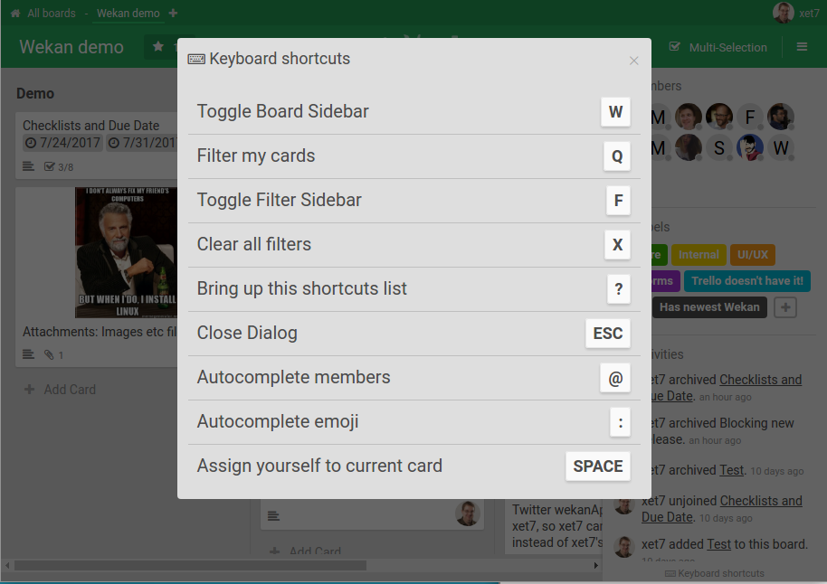

# Keyboard Shortcuts

WeKan has many keyboard shortcuts for fast, mouse-free use.

- Press **`?`** anywhere in WeKan to open the list of keyboard shortcuts.
- There is also a keyboard-shortcuts button at the bottom right corner.
- Keyboard shortcuts can be toggled on or off from the board sidebar.

## Opened card

These act on the opened card, or on the hovered or selected minicard when no
card is open:

| Key | Action |
| --- | --- |
| `d` | Edit the due date |
| `Shift` + `m` | Move Card ([#6904](https://github.com/wekan/wekan/issues/6904)) |
| `Shift` + `c` | Copy Card ([#6904](https://github.com/wekan/wekan/issues/6904)) |
| `c`, `-` | Move the card to the Archive |

Move Card and Copy Card open the same popups as the card's menu, so they are
there only for those who have them in that menu: Move Card for board admins,
Copy Card for everyone who is not a Worker. The popups open on the board,
swimlane and list chosen last time.

## Related

- [Accessibility](../Accessibility/Accessibility.md) — keyboard navigation, focus,
  and screen-reader support.
